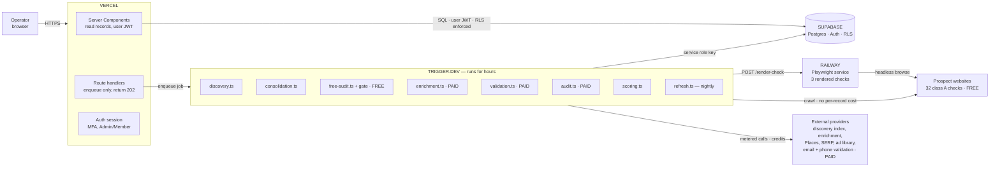
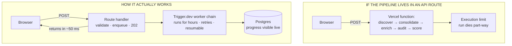
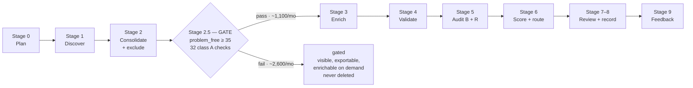
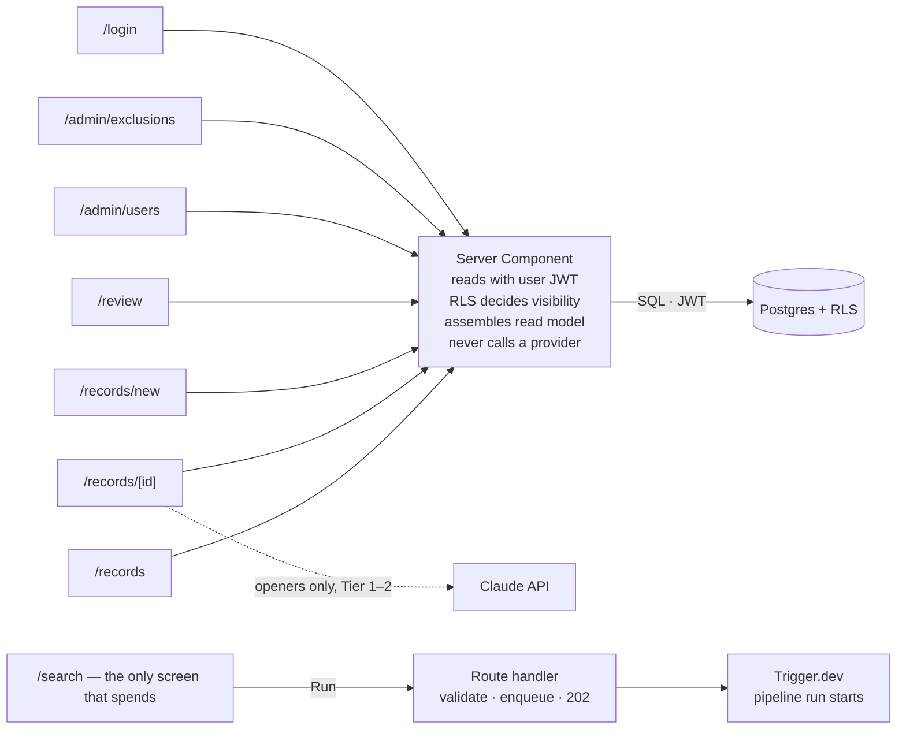
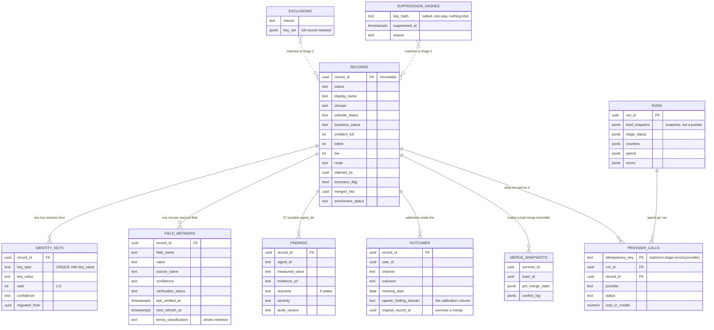

> # ⚠ PARTLY SUPERSEDED
>
> **Still correct:** the four deployment hosts, the requests-vs-runs rule, the identity keys
> table, the provider call ledger, field-level provenance, RLS, and the crawl policy.
>
> **Now wrong:** the discovery source (Store Leads / BuiltWith → **Google Places grid search**),
> the enrichment stage (Apollo → **removed**), the pipeline volumes, and the cost model.
>
> Read alongside `local-lead-intelligence-specification-v4.0.md`, which wins on anything to do
> with data sources, checks, scoring, or cost.

---

# System Architecture

**Lead Intelligence & Enrichment System — AheadTech360**

**Status:** Companion reference. Derived from approved documents; introduces no new decisions.
**Date:** 13 August 2026
**Companion to:** Final Specification v3.2, `scoring-model-v0.1.md`, `audit-test-catalogue-v0.1.md`, `development-build-guide.md`
**Visual version:** https://claude.ai/code/artifact/53fe385b-b5ab-4799-a09f-e41ee093f8c7

---

## 0. What this document is

The specification says what the system must do. The build guide says how to build it. Neither
shows **what connects to what and where each piece runs** in one view. This document does that,
and nothing else — every fact here traces back to one of the four documents above. Where they
disagree with this one, they win.

The system discovers US DTC apparel brands, works out what is broken about their online presence
using measurable tests, and hands a salesperson a record they can act on without repeating the
research. It does not send outreach and it is not a CRM.

**The three numbers everything is sized against** (Spec §8.2.1):

| Quantity | Per month | Cost class |
|---|---:|---|
| Discovered | 3,700 | Free — compute only |
| Enriched | 1,100 | Paid — $0.25–0.37 per record |
| Qualified | 325 | — |
| Monthly ceiling | — | $800 |

---

## 1. Deployment — four hosts, one repository

Everything is TypeScript in a single repo, but it deploys to four separate places because each
does a job the others cannot. The split is not a preference: a real enrichment run takes hours
and a web request cannot.



The browser never reaches a provider, and Vercel never runs pipeline work — it only enqueues.

| Host | Role | If it goes down |
|---|---|---|
| **Vercel** | Next.js 16 App Router. Server Components read Postgres with the signed-in user's JWT. API routes enqueue and return | Nobody can use the tool; runs already in flight continue |
| **Trigger.dev** | Eight workers, one per pipeline stage. Retries, backoff, dead-letter. Holds the service role key | No new runs; existing records still readable |
| **Railway** | Playwright behind one HTTP endpoint. Three rendered checks. Separate host because Playwright cannot run on Vercel | Those three checks return `unavailable`; nothing else breaks |
| **Supabase** | Postgres, Auth with MFA, Row Level Security. Every table, every provenance row, the cost ledger | Everything stops. Single point of failure, accepted for v1 |

---

## 2. The rule that shapes everything

A serverless function has an execution limit measured in seconds. A 500-record enrichment run
makes thousands of network calls. Those two facts are irreconcilable, so the pipeline lives
outside the web request.



The difference is one hop: the route stops at "enqueue". The operator watches progress by
reading the `runs` row, not by holding a connection open — closing the tab cancels nothing.

> **The rule.** Next.js handles requests. Trigger.dev handles runs. An API route may validate
> input, write a `runs` row, and enqueue a job. It may never call a provider, crawl a site, or
> score a record inline.

---

## 3. The pipeline, and the gate

A run walks a record through ten stages. The one that matters most is **Stage 2.5**: it runs the
free checks first, scores what they found, and only then decides whether this record is worth
paying to enrich. Without it the arithmetic does not close — 3,700 discovered records at any
real enrichment price would consume the monthly budget several times over.



**The gate is a spend decision, not a quality verdict.** A gated record stays in the system and
an operator can enrich it by hand; it simply does not get paid enrichment automatically.

### 3.1 What each stage does

| Stage | Worker | Reads | Writes | Calls out to | Cost |
|---|---|---|---|---|---|
| **0** Plan | route handler | brief, adapter capabilities | `runs` | nothing | free |
| **1** Discover | `discovery.ts` | `runs` | raw discovery rows | discovery index, ad library, directories | subscription |
| **2** Consolidate | `consolidation.ts` | discovery rows, `identity_keys`, `exclusions`, `suppression_hashes` | `records`, `identity_keys`, `merge_snapshots` | nothing | free |
| **2.5** Gate | `free-audit.ts` | `records` | class A `findings`, `problem_free` | prospect websites, PageSpeed Insights | free |
| **3** Enrich | `enrichment.ts` | gate-passers | `field_metadata`, `provider_calls` | enrichment provider | $0.25/rec |
| **4** Validate | `validation.ts` | contact fields | validation status, `provider_calls` | email + phone validation | $0.05/rec |
| **5** Audit | `audit.ts` | gate-passers | class B and R `findings` | Places, SERP, social, ad library, Railway | $0.07/rec |
| **6** Score | `scoring.ts` | `findings`, stored signals | scores, tier, route | nothing — pure function | free |
| **7–8** Review + output | UI, saved filters | everything | claims, overrides | Claude API for openers | on open |
| **9** Feedback | UI | — | `outcomes` | nothing | free |

Cost classes are defined in `scoring-model-v0.1.md` §3: **A** free (own crawl + PageSpeed),
**B** metered, **C** paid per record, **R** rendered (compute only).

---

## 4. Frontend

Eight screens. **Seven read; one spends.** Most screens are React Server Components that query
Postgres directly using the signed-in user's session, so authorisation is enforced by the
database rather than by a check somewhere in application code that one route can forget.



No screen holds an API key. No screen calls a data provider. Everything the browser sees came
from Postgres.

### 4.1 Screen by screen

| Screen | What the operator does here | Data source | Access |
|---|---|---|---|
| `/search` | Build a brief, add plain-English instructions, review the resolved filter set and the projected fetch-vs-keep cost (Spec §5.5), confirm the run | Reads adapter capabilities; POSTs to enqueue | Admin + Member |
| `/records` | Working list. Defaults to Tier 1–2; filters by route, score, website status, contact validation, gated state | Server Component → Postgres | Admin + Member |
| `/records/[id]` | The product. See §4.2 | Read model assembled server-side; Claude API for openers | Admin + Member |
| `/records/new` | Manual entry, so Phase 2 works before any adapter exists | Direct insert, provenance marked first-party | Admin + Member |
| `/review` | Saved filter, not a separate system. Identity conflicts, potential duplicates, key reassignments, routing with no evidence | Server Component → Postgres | Admin + Member |
| `/admin/exclusions` | CSV import/export of clients, past clients, trackers, do-not-contact | Postgres, Admin-only RLS policy | Admin |
| `/admin/users` | Add and remove users, set roles | Supabase Auth admin API | Admin |
| `/login` | Email + password with MFA | Supabase Auth | Everyone |

### 4.2 The record detail screen, in order

This screen is the entire product promise (Spec §1.1, §20), so its order is specified rather
than left to layout. It is ordered by what someone needs in the first fifteen seconds before a
call — not by how the data model is shaped.

1. **Header** — name, domain, tier, route, claim button, exclusion warning
2. **Why this lead** — routing reason, the finding that caused it, top three findings with
   evidence links. First, because the opener is built from this
3. **Contacts** — each channel with its validation status next to the value, not in a tooltip
4. **Openers** — call and Instagram DM, each naming the finding it drew from
5. **Evidence** — all findings by domain, including passed and not-measured
6. **Company** — firmographics and technographics
7. **Provenance** — per-field source, confidence, last verified
8. **History** — outcomes, claims, merges, key migrations

> **Four display rules that are not styling preferences** (Spec §20.2). A verified email and a
> guessed email must never look alike. `unknown` renders as a labelled state, never a blank cell
> — a blank reads as a broken interface. Checks that could not run appear under "not measured",
> because omitting them implies they passed. An opener that cannot name its source finding is
> not generated at all.

---

## 5. Backend internals

Three mechanisms carry the weight.

### 5.1 The identity keys table

A business is not identified by one field. It might be found by domain today, by a Google Place
ID next week, and by an Instagram handle after that. All keys live in one table with
`unique(key_type, key_value)`, so looking up a business by **any** key is a single indexed
query, and one-business-one-record is enforced by Postgres rather than by application code.

When a new key collides with a key another record already owns, the insert fails with a
constraint violation. That is not an error to swallow — it is the signal that two records may be
the same business. The worker catches Postgres `23505` and either merges (only on a domain or
Place ID match, never on a weak key) or queues the pair for a human. See Spec §4.5 and Build
Guide §3.4.

### 5.2 The provider call ledger

Every paid call writes a row keyed by `hash(run_id, stage, record_id, provider)` in the same
transaction as the data it bought. Before any paid call the worker looks the key up; a retried
job finds its row and reuses the result instead of buying the same data twice.

The same table is the cost ledger — cost per enriched record is a query against it, not an
estimate.

### 5.3 Field-level provenance

Every externally sourced field carries source, confidence, verification status, and timestamps
(Spec §7.3). This is the one thing that genuinely cannot be added later: a dataset that grows
for three months without it has three months of fields whose origin is permanently unknowable,
and every retention rule becomes unenforceable at once.

### 5.4 When something fails

Failure is a first-class output, not an exception. The run row records every error with its
stage and provider, so a broken collector is never mistaken for a genuine zero-result search.

| Code | Retry | Effect | Operator sees |
|---|:--:|---|---|
| `PROVIDER_TIMEOUT` | yes | Backoff and retry | nothing unless persistent |
| `PROVIDER_RATE_LIMITED` | yes | Backoff per adapter rate limit | run takes longer |
| `PROVIDER_QUOTA_EXHAUSTED` | no | Halt that provider for the run, others continue | partial run, named stage |
| `PROVIDER_SCHEMA_INVALID` | no | Dead-letter the response. Never coerce or patch | alert — provider changed shape |
| `PROVIDER_AUTH_FAILED` | no | Halt run | alert |
| `FETCH_BLOCKED` | no | Every dependent check becomes `unavailable` | "not measured" on the record |
| `FETCH_NOT_FOUND` | no | Field is `not_found` | labelled state |
| `BUDGET_CEILING_REACHED` | no | Halt gracefully, completed work persists | run marked halted, with spend |
| `IDENTITY_CONFLICT` | no | Manual review | appears in `/review` |
| `INTERNAL` | no | Dead-letter | alert |

> **Blocked is not passed.** A Cloudflare challenge, a 403, or a timeout produces
> `FETCH_BLOCKED`, and every dependent check returns `unavailable` — excluded from both the
> numerator and the attainable maximum of the score. Recording a site we could not read as a
> site with no problems would corrupt the score that decides where the money goes, and it would
> do it silently.

### 5.5 Crawl policy

First-party crawling is load-bearing — the free checks that gate all spend are built entirely
from it — so it behaves like a good citizen rather than a scraper (Build Guide §9).

| Rule | Setting |
|---|---|
| User-Agent | Honest, identifies AheadTech360, with a contact URL. Never spoofed |
| robots.txt | Fetched first and respected; `Disallow: /` is itself a recorded finding (S1) |
| Concurrency | One request in flight per host |
| Delay | Minimum 2s between requests to the same host |
| Budget | 10 pages and 30 seconds per record; 15s per request |
| Authentication | Never crawl behind a login |
| Forms | Never submitted, except check E6 using an AT360-controlled address |
| Payments | Rendered checkout checks traverse to the payment step and stop |

Block rate is tracked as an operational metric. Above 15%, a residential proxy pool becomes
necessary — a real cost line not in the current budget, so it needs a decision rather than a
quiet addition.

---

## 6. Data model

Ten tables. `records` sits in the middle and almost everything hangs off it. The two that look
optional and are not: `field_metadata`, which makes every value explainable, and
`provider_calls`, which makes every dollar accountable.



Exclusions and suppression hashes are matched **before any paid call**, so an existing client
never costs enrichment credits. The two are different mechanisms: exclusion retains the full
record in a restricted area with its reason; suppression retains identifier hashes only
(Spec §13.1).

---

## 7. External services

The system must keep working with any single enrichment provider disabled (Spec §17). That is
why **no deficiency score depends on a paid provider**.

| Service | Called by | For | Class | If unavailable |
|---|---|---|---|---|
| Discovery index (Store Leads / BuiltWith) | `discovery.ts` | Finding DTC stores by platform, geography, industry | sub | No new discovery; existing records unaffected |
| Prospect websites | `free-audit.ts` | 32 free checks — the gate itself | A | Checks `unavailable`; record goes to review, not to a score |
| PageSpeed Insights | `free-audit.ts` | LCP, CLS, TBT, performance score | A | Four speed signals drop out of the gate |
| Enrichment provider | `enrichment.ts` | Decision makers, firmographics, work emails | C | Records enrich from first-party sources only, clearly marked |
| Email validation | `validation.ts` | Deliverability | C | Emails stay `not_yet_validated`, distinct from `not_found` |
| Phone validation | `validation.ts` | Validity, line type | C | As above |
| Google Places | `audit.ts` | Place ID, reviews, ratings, owner responses | B | Reputation domain suppressed by the coverage floor, not scored as zero |
| SERP lookup | `audit.ts` | Brand-name search position | B | Two SEO signals drop out |
| Meta Ad Library | `discovery.ts`, `audit.ts` | Whether the brand is currently advertising | B | **Intent loses 40 of 100 points** — verify coverage before Phase 3 |
| Playwright on Railway | `audit.ts` | Checkout steps, guest checkout, signup submission | R | Three checks `unavailable`; nothing else affected |
| Claude API | Record detail screen, `enrichment.ts` | Description, review themes, filter parsing, openers | on open | Openers unavailable; every finding and score intact |

> **Where AI is and is not allowed** (Build Guide §4). Four jobs only: parse plain-English search
> text, write a one-line description, summarise review themes, write openers. Prohibited from
> identity matching, deduplication, merge, scoring, routing, and generating findings. **Code
> measures; the model may only phrase what was measured.** Anything compared across versions must
> be deterministic, and a model whose output varies between identical runs cannot be calibrated.

---

## 8. Environments and secrets

One repository, three deploy targets, one database. The important split: the service role key —
which bypasses Row Level Security — exists only on Trigger.dev.

| Secret | Vercel | Trigger.dev | Railway | Why |
|---|:--:|:--:|:--:|---|
| `SUPABASE_URL` | ✓ | ✓ | — | Both read the database |
| `SUPABASE_ANON_KEY` | ✓ | — | — | Web app acts as the signed-in user |
| `SUPABASE_SERVICE_ROLE` | — | ✓ | — | **Never on Vercel.** Bypasses RLS |
| `TRIGGER_API_KEY` | ✓ | — | — | Route handlers enqueue jobs |
| Provider API keys | — | ✓ | — | Only workers spend money |
| `ANTHROPIC_API_KEY` | ✓ | ✓ | — | Openers on demand; descriptions during enrichment |
| `BROWSER_SERVICE_TOKEN` | — | ✓ | ✓ | Shared secret between worker and Playwright |
| `SUPPRESSION_SALT` | — | ✓ | — | Held outside the database so hashes stay irreversible |

**Deploy flow**

- Push to `main` → Vercel builds and deploys the web app
- Same push → Trigger.dev CLI deploys the workers
- Railway rebuilds the Playwright container on changes under `apps/browser`
- **Drizzle migrations run as an explicit step before either deploy, never automatically** — an
  identity-table migration that runs mid-run is not recoverable
- One environment for v1. A staging Supabase project is worth adding before the first migration
  that touches `identity_keys`

---

## 9. Build order

Phase 0 — the manual research on 40 businesses — runs in parallel with Phases 1 to 4. Only
Phase 5 depends on its results.

| Phase | What exists at the end of it | Done when |
|---|---|---|
| **1** Data model | Drizzle schema, normalisation, identity keys, merge and late merge, exclusion and suppression matching, `core` unit tests. No UI | The 40 Phase 0 brands load without duplicates, a re-import creates nothing new, and the changed-owner domain does **not** merge |
| **2** Platform shell | Auth, roles, RLS policies, record list, record detail, manual entry form, claim and release, CSV export | The team can work entirely from the tool on hand-entered data, and a Member provably cannot exceed their role |
| **3** Discovery and free signals | Trigger.dev scaffolding, discovery adapter, crawler under the crawl policy, all 32 class A checks, PageSpeed Insights | A brief returns deduplicated records with provenance and a `problem_free` score on every one |
| **4** The gate and paid enrichment | Stage 2.5, provider call ledger, enrichment adapter, email and phone validation, partial-failure handling | A record is usable for outreach without manual research, a deliberately retried run buys nothing twice, and measured cost per record is inside the ceiling |
| **5** Remaining audit and scoring | Playwright service, class B checks, scoring model, routing with displayed reasons, openers | Every finding carries evidence and every score shows its signals |
| **6** Feedback | Outcome logging per channel including the opener's finding domain, attribution, calibration dashboard | — |
| **7** Second vertical | Discovery rebuilt for the new vertical; enrichment, audit, and scoring transfer unchanged | First market meets its quality and conversion gates |

Class A checks live in Phase 3, not Phase 5, because the Phase 4 spend gate depends on them.
Building them later would mean shipping enrichment with no cost control.

> **Three things to verify before building on them** (Build Guide §10).
> **Meta Ad Library** — does its API actually serve commercial ads for US apparel? Forty of the
> hundred Intent points depend on it.
> **Discovery pricing** — must be a subscription. At 3,700 records a month, per-record pricing
> consumes the entire budget on its own.
> **PageSpeed Insights quota** — must cover roughly 3,700 records a month, or the gate loses its
> strongest signals.

---

## 10. Repository layout

```
lead-intel/
├─ apps/
│  ├─ web/                    → Vercel (Next.js)
│  │  ├─ app/
│  │  │  ├─ (auth)/
│  │  │  ├─ records/          list, detail (§4.2), create/edit
│  │  │  ├─ search/           brief builder + run planner
│  │  │  ├─ review/           manual review queue (a filtered view)
│  │  │  ├─ admin/            users, exclusion list, suppression requests
│  │  │  └─ api/              thin — enqueue jobs only
│  │  └─ components/
│  │
│  ├─ jobs/                   → Trigger.dev
│  │  └─ tasks/
│  │     ├─ discovery.ts
│  │     ├─ consolidation.ts
│  │     ├─ free-audit.ts     class A checks + Stage 2.5 gate
│  │     ├─ enrichment.ts
│  │     ├─ validation.ts
│  │     ├─ audit.ts          class B + R checks
│  │     ├─ scoring.ts
│  │     └─ refresh.ts        nightly refresh, retention purge, key re-verification
│  │
│  └─ browser/                → Railway (Playwright service)
│     └─ src/
│        ├─ server.ts         HTTP endpoint the audit job calls
│        └─ checks/           checkout traversal, signup submission
│
├─ packages/
│  ├─ db/                     Drizzle schema + migrations
│  ├─ core/                   identity, normalisation, merge, scoring, routing — no network calls
│  ├─ providers/              one adapter per external source + recorded fixtures
│  ├─ ai/                     versioned prompts + Zod output schemas
│  └─ shared/                 types, Zod schemas, enums
```

`packages/core` is where correctness is decided and where the non-negotiable unit tests live.
Keeping it free of network calls is what makes it testable.

---

## 11. Where the volumes come from

Every number in this document derives from two approved decisions (Spec §18 items 5 and 6) and
two assumptions that are **measurable from the first month of runs and must be replaced with
observed rates**:

| Input | Value | Source |
|---|---|---|
| Weekly qualified-lead target | 50–100, planning midpoint 75 | Approved, §18 item 5 |
| Monthly provider budget | $300–800 | Approved, §18 item 6 |
| Share of enriched records reaching qualified | ~30% | **Assumption** |
| Stage 2.5 gate pass rate | ~30% | **Assumption** |

Those two assumptions are the softest numbers in the entire architecture. If the gate pass rate
turns out to be 50%, enrichment volume rises by two thirds and the budget breaks. The control
lever is `gate_min_problem_free` — raising it reduces how many records get paid enrichment
(Spec §8.2.4). The quality bar on records that do pass is never lowered to fit the budget.
